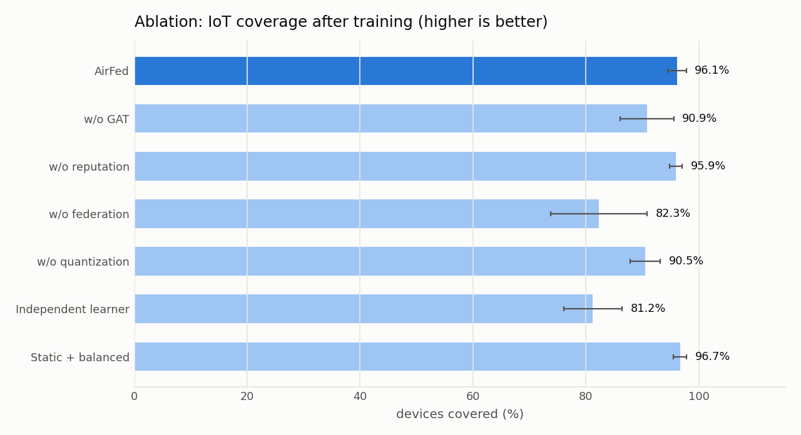
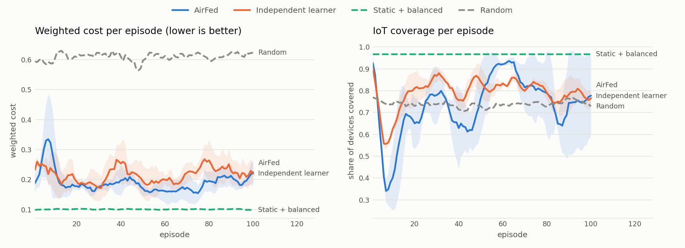
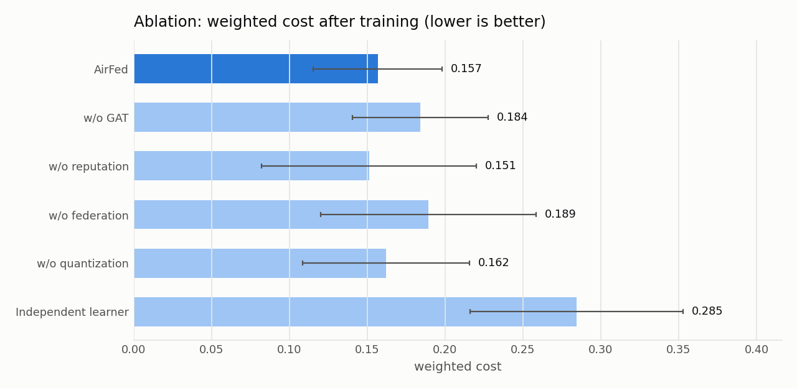
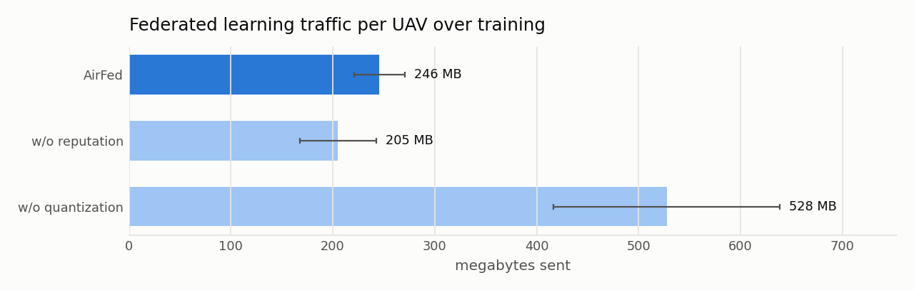
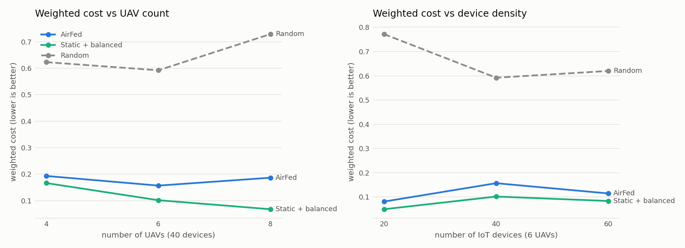

# AirFed: drones that learn together to run IoT tasks

This is my implementation of the paper **AirFed: A Federated Graph-Enhanced Multi-Agent Reinforcement Learning Framework for Multi-UAV Cooperative Mobile Edge Computing** by Zhiyu Wang, Suman Raj and Rajkumar Buyya ([arXiv:2510.23053](https://arxiv.org/abs/2510.23053)).

It contains the simulator from the paper's system model, the full AirFed method (graph attention, dual-actor single-critic, reputation-weighted federated learning with adaptive quantization), the paper's ablations, a few reference policies, tests, and scripts that regenerate every number and figure in this README.

## The problem, in plain words

Picture a 1 km × 1 km area with 40 small IoT devices on the ground: sensors, cameras, meters. Every few seconds each one produces a job it is too weak to run, like "analyse this 2 MB image". Six drones fly above the area, each carrying a small computer. A device sends its job to the drone with the strongest signal, the job gets computed in the air, and the answer comes back down.

Every drone has to keep making two kinds of decisions:

1. **Where to fly.** Flying costs energy, but drifting away from devices means weaker links and devices left without coverage.
2. **Who runs each job.** The drone can run it itself, or hand it to a neighbouring drone that is less busy or has a faster CPU, which costs an extra radio hop.

The goal is to finish jobs quickly, spend little energy, meet every job's deadline and keep as many devices covered as possible. It's hard because the decisions depend on each other, the picture changes as drones move, there is no central controller, and drones can only talk to drones within 400 m.

## How AirFed solves it

AirFed gives every drone its own learning agent, built from three ideas.

**1. A graph view of the neighbourhood (dual-layer graph attention).**
Each drone builds two small graphs around itself. The *cooperation layer* holds the drone and the drones it can reach; the *service layer* holds the devices it currently covers. Graph attention lets the drone weigh what matters, for example "that neighbour is close, idle and has a fast CPU", instead of averaging everything. The service layer feeds into the cooperation layer, with urgent devices (short deadlines) counting more. A GRU on top gives the drone short-term memory between steps.

**2. Two actors and one critic.**
The two decisions are different in kind. Flying is continuous (a velocity vector), and offloading is a discrete choice (here, or neighbour 1, 2, ...). AirFed uses a *velocity actor* that outputs a Gaussian over velocities and an *offloading actor* that outputs probabilities over targets. One *critic* estimates how good the current situation is, and both actors learn from the same advantage signal.

**3. Learning from neighbours without a server (reputation-weighted federated learning).**
Every so often a drone asks nearby drones for their actor and critic weights and averages them with its own. Not every neighbour is equally trustworthy, so each model is weighted by a reputation score built from how often that drone finishes tasks on time and how reliably its updates arrive. To save radio bandwidth, the weights travel *quantized*. Parameters with large gradients (the ones that matter most) keep up to 16 bits, and the rest shrink to as few as 4.

## Results

Every number here comes from `scripts/run_experiments.py`: 100 training episodes per run, 3 seeds for the main setup and 2 for the scaling runs. A trained policy is scored on 5 fresh episodes whose tasks never appeared in training. It flies with its mean velocity (no exploration noise) and offloads with its learned probabilities. Full tables are in [`results/summary.md`](results/summary.md), and the raw per-episode CSVs are in `results/`.

### Main comparison (6 drones, 40 devices)

| Method | Time per task | Energy per drone | Weighted cost | Coverage | Tasks dropped |
| --- | --- | --- | --- | --- | --- |
| **AirFed** | 0.77 s ± 0.07 | 24.21 kJ | 0.157 ± 0.041 | 96.1% ± 1.6 | 4.5% |
| w/o GAT | 0.81 s ± 0.08 | 24.21 kJ | 0.184 ± 0.044 | 90.9% ± 4.8 | 8.6% |
| w/o reputation | 0.76 s ± 0.12 | 24.20 kJ | 0.151 ± 0.069 | 95.9% ± 1.2 | 3.7% |
| w/o federation | 0.82 s ± 0.12 | 24.41 kJ | 0.189 ± 0.069 | 82.3% ± 8.6 | 17.4% |
| w/o quantization | 0.78 s ± 0.09 | 24.20 kJ | 0.162 ± 0.054 | 90.5% ± 2.7 | 8.8% |
| Independent learner (no GAT, no federation) | 0.92 s ± 0.03 | 26.00 kJ | 0.285 ± 0.068 | 81.2% ± 5.2 | 18.8% |
| Static + balanced (hand-made) | 0.67 s ± 0.05 | 24.18 kJ | 0.102 ± 0.031 | 96.7% ± 1.2 | 3.5% |
| Static + local (hand-made) | 0.66 s ± 0.05 | 24.17 kJ | 0.096 ± 0.029 | 96.7% ± 1.2 | 3.5% |
| Random | 0.88 s ± 0.01 | 41.85 kJ | 0.592 ± 0.007 | 75.0% ± 1.8 | 24.9% |

Weighted cost is the paper's Eq. 31: half normalised time plus half normalised energy, each min-max scaled over every run of the same setup. Every method met 99.9-100% of deadlines for the tasks it served, so that column is left out.



### What the numbers say

- **AirFed learns a good policy from scratch.** Starting from random networks, the drones learn to hold position near the devices (energy settles at the 24.2 kJ hover floor), cover 96.1% of devices and finish tasks in under a second.
- **Federated learning matters most.** Without it, coverage falls to 82.3% and swings widely between seeds (±8.6 points). Drones learning alone end up in poor positions more often. This is the same ranking the paper reports, where "w/o Fed" is the worst ablation.
- **The graph view helps.** Replacing the GAT with a plain average costs 5 points of coverage (90.9%). Removing both the GAT and federation gives the weakest learner and the only one that wastes flight energy.
- **Quantization cuts radio traffic by 53.4% without hurting learning.** Each drone sends 246 MB over training instead of 528 MB; the paper reports 54.5%. The quantized version actually finished slightly ahead in these runs.
- **Reputation makes no measurable difference here** (95.9% vs 96.1%). Reputation earns its keep when some partners are unreliable or misbehave. In this simulation every drone is honest and exchanges rarely fail, so there is little to protect against. Testing that claim properly needs faulty or adversarial drones.
- **The hand-made static policy is hard to beat in this setting.** Devices never move and their traffic is fixed, so hovering at the k-means centres, where every policy starts, is already close to optimal. AirFed matches its coverage and energy but is about 0.1 s slower per task. That is likely because it sometimes forwards tasks that would have run fine locally (running everything locally is the fastest option at this load) and settles slightly further from devices. Learning should pay off when things change, with moving users or shifting traffic, which this static scenario doesn't test.

### Compared with the paper

| Metric | Paper (AirFed) | This implementation |
| --- | --- | --- |
| Average task time | ~0.9 s | 0.77 s |
| Energy per drone per 300 s episode | ~27 kJ | 24.2 kJ |
| IoT coverage | 94.2% | 96.1% |
| Deadline satisfaction | >99% | ~100% of served tasks |
| Traffic saved by quantization | 54.5% | 53.4% |
| Worst ablation | w/o federation | w/o federation |
| Weighted cost vs other methods | 42.9% below IF-DDPG | not comparable: the baselines differ, and min-max scores depend on which runs are pooled |

### Training curves



These are training episodes with exploration noise on, averaged over seeds (shaded band = one standard deviation). On-policy actor-critic swings up and down: a policy can reach 93% coverage and then lose it for a while. That's why each run hands back the snapshot with the best 5-episode training reward, and why the final scores above come from separate evaluation episodes, not from these curves.

### Ablations and communication





### Scalability



| Drones-devices | AirFed coverage | Static coverage | AirFed time | Static time |
| --- | --- | --- | --- | --- |
| 4-40 | 82.9% | 95.0% | 0.76 s | 0.73 s |
| 6-20 | 95.0% | 95.0% | 0.49 s | 0.47 s |
| 6-40 | 96.1% | 96.7% | 0.77 s | 0.67 s |
| 6-60 | 98.6% | 99.2% | 0.92 s | 0.86 s |
| 8-40 | 94.6% | 100% | 0.79 s | 0.63 s |

AirFed stays far ahead of random flight at every size and close to the static policy. With only 4 drones it gets coverage wrong more often: each drone has to cover more ground, so a small positioning mistake leaves more devices out.

## The simulator

The environment follows the paper's system model (Section III) and its parameter table (Section V). One episode is 300 seconds, split into 30 steps of 10 seconds. In every step:

1. **Tasks appear.** Each device generates tasks as a Poisson process at 0.3-0.8 tasks/s. A task needs 50-200 million CPU cycles, uploads 1-3 MB, returns 0.1-0.5 MB and has a 5-20 s deadline.
2. **Upload.** The device sends the task to the drone with the strongest signal, if that signal is above -90 dBm; otherwise the task is dropped because the device is out of coverage. The upload rate is Shannon's formula over 10 MHz (Eq. 9).
3. **Offloading decision.** The serving drone samples a target from its offloading actor: itself, or one of its neighbours within 400 m, in order of distance. Forwarding uses the 20 MHz drone-to-drone link (Eqs. 12-14).
4. **Computing.** Each drone runs its tasks first-in first-out on a 1-3 GHz CPU. The waiting time in that queue is real, so overloading one drone shows up as delay (Eq. 15).
5. **Return.** The result goes back along the same path and down to the device (Eqs. 16-17).
6. **Flight.** Every drone flies with the velocity its velocity actor chose (at most 20 m/s), paying hover power plus air drag (Eq. 19).

Delay is the sum of upload, decision, forwarding, queueing, computing, return and download (Eq. 7). Energy is flight plus every radio and CPU cost along the path, charged to the drone that actually spends it (Eqs. 18-30). Drones start at k-means centres of the devices, as in the paper.

Each drone's reward is the paper's (Eqs. 67-70): minus its weighted time-and-energy cost for the step, minus 10× the deadline overrun, plus 0.1 for every device it covers.

## Paper to code

| Paper | What it is | Where |
| --- | --- | --- |
| Eqs. 2-6 | distance, channel gain, RSSI, coverage, serving drone | `airfed/env/channel.py`, `UAVEdgeEnv._links` |
| Eqs. 7-17 | task delay (upload, decision, forward, queue, compute, return, download) | `UAVEdgeEnv.step` |
| Eqs. 18-30 | flight and task energy | `UAVEdgeEnv.step`, `channel.flight_power` |
| Eqs. 31-35 | weighted cost with min-max normalisation | `scripts/make_plots.py::add_cost` |
| Eqs. 36-43 | speed limit, kinematics, time step, range, load | `UAVEdgeEnv.step`, `UAVEdgeEnv._observe` |
| Eqs. 46-49 | node and edge features | `UAVEdgeEnv._observe` |
| Eqs. 52-55 | dual-layer graph attention, cross-layer urgency matrix | `airfed/models/gat.py` |
| Eq. 56 | GRU memory | `Agent.forward` |
| Eqs. 61-66 | shared layer, velocity actor, offloading actor, critic | `airfed/models/agent.py` |
| Eqs. 67-70 | reward | `UAVEdgeEnv._rewards` |
| Eq. 74 + advantage | actor-critic loss with entropy bonus | `airfed/train.py::update` |
| Eqs. 76-81 | partner selection and reputation | `airfed/fl/reputation.py`, `airfed/fl/federation.py` |
| Eqs. 82-84 | gradient-sensitive bit widths, quantize, dequantize | `airfed/fl/quantize.py` |
| Eqs. 85-89 | mobility-aware aggregation timer, weighted averaging | `airfed/fl/federation.py` |
| Algorithm 1 | the whole training loop | `airfed/train.py::train` |

## Where the paper was unclear, and what I chose

A paper can't print every detail, and a few values don't work as printed. Every choice below is in `airfed/config.py`, marked "ours", so it is easy to change.

| Topic | Paper | What I did | Why |
| --- | --- | --- | --- |
| Air-to-ground path loss | free space, exponent 2 | exponent 3.5 | With exponent 2 and the given powers, a device is "covered" from 22 km away and coverage is always 100%. Exponent 3.5 gives a ~280 m footprint, and the k-means start then covers ~95% of devices, matching the paper's 94.2%. |
| CPU energy constant κ | 10⁻¹⁸ | 10⁻²⁸ | With f in Hz, 10⁻¹⁸ makes one task cost ~500 MJ, a thousand times the battery. 10⁻²⁸ gives about 0.05 J per task. |
| Uplink interference | sum over every other device | only devices served by other drones, weighted by how long they transmit | Read literally, devices in the same cell jam each other and uploads crawl at ~9 Mbps. Real cells schedule their own devices. With this change, task times land near the paper's ~0.9 s. |
| Time step Δt | must satisfy Δt ≥ 2·v_max/a = 8 s | 10 s (30 steps per episode) | Smallest round value that satisfies Eq. 38. |
| Downlink rate | "similar to uplink" | Shannon formula with drone transmit power, no interference | |
| Decision time, idle power | not given | 5 ms per hop, 2 W | Small and realistic; they barely affect results. |
| Offloading action | "local or forward to neighbours" | slot 0 = local, slot i = i-th nearest neighbour in range; full drones (backlog > 20 s) are masked out | Slot meanings are the same for every drone, so averaging actors across drones in federated learning makes sense. |
| Offloading actor input | shared features only | shared features + each slot's load, CPU speed and link rate | Otherwise the actor can't tell which neighbour a slot stands for. |
| One decision per task | not specified | every task samples a slot from its serving drone's distribution; the gradient uses the average log-probability of the slots chosen | Many tasks arrive per step; this keeps one action head per step. |
| Velocity distribution | Gaussian | Gaussian squashed with tanh, scaled to 20 m/s, starting std ≈ 0.14 | Respects the speed limit smoothly. A larger starting std made drones wander off during early training. |
| GAT details | attention formula only | linear query/key/value per head, edge features added as an attention bias, layers fused by concatenation | Standard choices that follow Eqs. 52-55. |
| RL update | one-step advantage A = r + γV' - V; buffer and batch size not given | update after every step, using that one-step advantage, gradient clipping at 1.0 | Updating every step learned clearly better than every 5 steps in my tests. |
| Deadline penalty | -λ·max(0, T - c) per task | averaged over the drone's tasks in the step | Keeps one busy step from swamping the rest of the signal. |
| Reward normalisation | min-max over all runs (not usable online) | time ÷ 20 s; energy scaled between hover and full speed | The paper's own min-max is still used for the reported weighted cost. |
| Deadline rate | "tasks completed within deadline" | measured over tasks that were served; tasks from uncovered devices are reported separately as "dropped" | Matches the paper's >99% with 94% coverage. |
| Quantization | per-parameter bits, θ_min/θ_max | min/max per tensor; message size counts values, a 4-bit width id per value, and each tensor's min/max | An honest size, so the savings aren't overstated. |
| Area border | not modelled | drones are stopped at the border, but flight energy follows the commanded speed | In early runs, pushing against the border cost the same as hovering, and some policies got stuck in a corner for good. Charging for the commanded speed removed that trap. |
| Reporting a trained policy | not specified | the snapshot with the best 5-episode training reward, scored on 5 unseen episodes with its mean velocity | On-policy actor-critic oscillates during training (see the curves above), so the last episode is a poor summary. |
| Federated exchange failures | timeout, value not given | an exchange is lost with probability 2% + 20%·(d/400 m)² | Gives the reputation's "stability" term something to measure. |

## Running it

You need Python 3.10+ and about 2 GB of disk for PyTorch. A GPU isn't needed; everything runs on a laptop CPU.

```bash
python -m venv .venv
.venv\Scripts\activate            # Windows   (macOS/Linux: source .venv/bin/activate)
pip install -r requirements.txt

pytest                             # 18 tests: physics, rewards, networks, quantization, federation
```

Train one model or run one baseline. 100 episodes with 6 drones take about 5 minutes. A trained model is saved next to its CSV and scored on 5 unseen episodes at the end:

```bash
python -m airfed.train --variant airfed --episodes 100 --seed 0
python -m airfed.train --variant no_fed --episodes 100           # any ablation: no_gat, no_reputation, no_fed, no_quant, independent
python -m airfed.train --baseline static_balanced --episodes 100
python -m airfed.train --variant airfed --uavs 8 --devices 60    # other sizes
```

Reproduce every table and figure in this README:

```bash
python scripts/run_experiments.py           # all 51 runs, about an hour on 2 CPU cores (resumable)
python scripts/run_experiments.py --quick   # a 10-minute version with fewer episodes and one seed
python scripts/make_plots.py                # writes figures/ and results/summary.md
```

Each run writes one CSV per training run to `results/runs/` (one row per episode) and one per evaluation to `results/eval/`.

## Project layout

```
airfed/
  config.py            every setting, marked "paper" or "ours"
  env/channel.py       radio and power formulas (Eqs. 2-19)
  env/uav_env.py       the simulator: tasks, offloading, queues, delay, energy, reward
  models/gat.py        dual-layer graph attention (Eqs. 52-55) and the MLP used by the ablation
  models/agent.py      GRU, shared layer, velocity actor, offloading actor, critic
  fl/quantize.py       gradient-sensitive adaptive quantization (Eqs. 82-84)
  fl/reputation.py     reputation scores (Eqs. 77-80)
  fl/federation.py     decentralised, reputation-weighted aggregation (Eqs. 85-89)
  baselines.py         random, static + local, static + balanced
  train.py             Algorithm 1, evaluation, baseline runner, command line
scripts/
  run_experiments.py   the full experiment grid
  make_plots.py        figures and results/summary.md
tests/                 pytest suite
results/               CSVs from my runs and summary.md
figures/               the plots in this README
```

## Limitations and next steps

- **Small training budget.** Each run is 100 episodes of 30 decisions per drone. Reinforcement learning at this scale varies from seed to seed, which is why the tables show the spread across seeds. More episodes and seeds would tighten it.
- **The paper's learning baselines aren't reimplemented.** IF-DDPG, MUTO, JTORA and BCD-SCA are separate papers with their own designs, so I compare against AirFed's own ablations and transparent hand-made policies instead.
- **Deadlines are generous at this load.** With 5-20 s deadlines and sub-second completion times, almost every served task is on time. The 60-device setting is where offloading choices start to matter.
- **Static devices.** As in the paper, devices don't move and their rates stay fixed within a scenario. Moving users or changing traffic would make trajectory learning more valuable.
- **Simulated federated links.** Exchange losses use a simple distance-based model, not a real radio stack.

## Reference

Zhiyu Wang, Suman Raj, Rajkumar Buyya. *AirFed: A Federated Graph-Enhanced Multi-Agent Reinforcement Learning Framework for Multi-UAV Cooperative Mobile Edge Computing.* arXiv:2510.23053, 2025.
